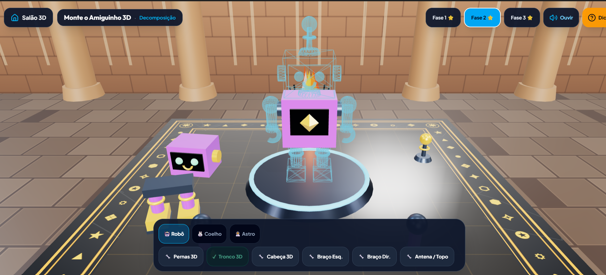
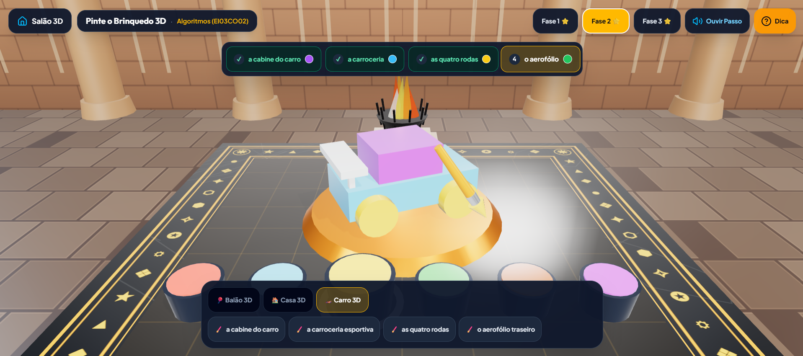
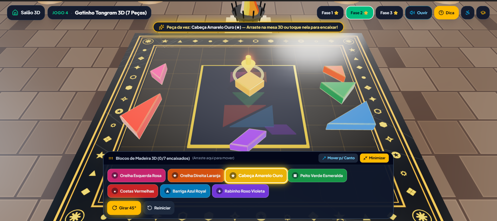

# 🤖 EduGames Kids 3D — Pensamento Computacional na Educação Infantil

[](http://portal.mec.gov.br/)
[-10b981?style=for-the-badge)](#)
[](#)
[](#)
[](#)

> **Plataforma educacional interativa em 3D (WebGL / Three.js) e Progressive Web App (PWA Offline-First)** desenvolvida para crianças de **4 a 5 anos (Pré-Escola)**, professores e famílias. Alinhada integralmente ao **Complemento à BNCC de Computação (Resolução CNE/CEB nº 2/2022)**, desenvolvendo os quatro pilares do Pensamento Computacional sem exigir leitura.

---

## 📸 Visão Geral e Imagens do Jogo

### 1. Monte o Amiguinho 3D — *Pilar: Decomposição*
As peças tridimensionais do Robô Bit (ou Coelhinho / Astronauta) ficam dispostas sobre a bancada de mármore e runas douradas. A criança arrasta e conecta cada membro 3D com trava magnética, efeitos sonoros de servomotor, faíscas 3D e celebração interativa em duas colunas (acendendo luzes, movendo membros e emitindo sons robóticos *"Bip-Bop-Buzzz!"*).



---

### 2. Pinte o Brinquedo 3D — *Pilar: Algoritmos e Sequência de Etapas*
Um ateliê de pintura tridimensional onde o pincel 3D acompanha o movimento do mouse/toque em tempo real, mergulha nos potes de tinta acrílica (com paleta acessível Okabe-Ito e símbolos geométricos) e pinta passo a passo o Foguete, a Casinha ou o Carro Esportivo conforme a sequência algorítmica falada pelo mascote Bit.



---

### 3. Tangram de Madeira 3D — *Pilar: Abstração e Geometria Espacial*
Blocos chanfrados de madeira nobre com tesselação planar exata e simetria rotacional (`45°`, `90°`, `180°`). A criança gira e encaixa triângulos, quadrados e paralelogramos para abstrair silhuetas complexas (Casinha, Gatinho de 7 peças e Foguete Espacial).



---

## 🎓 Filosofia e Propósito Pedagógico

### 1. Concepção Pedagógica: Brincar, Interagir e Pensar na Pré-Escola
De acordo com as **Diretrizes Curriculares Nacionais para a Educação Infantil (DCNEI — Resolução CNE/CEB nº 5/2009)**, os eixos estruturantes das práticas pedagógicas nessa etapa são as **interações** e a **brincadeira**. Na faixa etária de **4 e 5 anos**, a criança encontra-se em transição do pensamento sensório-motor para o pensamento simbólico e intuitivo (Piaget) e aprende por meio da mediação concreta, visual e auditiva (Vygotsky).

O **EduGames Kids 3D** traduz conceitos abstratos da Ciência da Computação em **objetos tridimensionais manipuláveis** (blocos de madeira, engrenagens de robô, potes de tinta e tabuleiros iluminados), garantindo que:
- **Nenhuma atividade dependa de leitura ou decodificação alfabética:** todas as instruções são narradas em português do Brasil via síntese de voz (`Web Speech API`) e acompanhadas por setas guias 3D pulsantes e pictogramas.
- **O erro nunca seja punitivo:** tentativas incorretas geram dicas acolhedoras em áudio e realces luminosos dourados no objeto 3D correto, promovendo a **depuração (*debugging*)** como parte natural da descoberta.

---

### 2. Os 4 Pilares do Pensamento Computacional

| Pilar Computacional | Definição na Educação Infantil | Aplicação Prática no EduGames Kids 3D |
| :--- | :--- | :--- |
| **1. Decomposição** | Dividir um objeto ou desafio grande em partes menores e mais fáceis de compreender. | Separar o robô em *cabeça, tronco, pernas, braços e antena* (**Jogo 1**) ou subdividir uma pintura em blocos espaciais (**Jogo 2**). |
| **2. Reconhecimento de Padrões** | Identificar regularidades, ciclos que se repetem e regras de formação (cor, forma, escala e som). | Observar o trilho dourado 3D (*Esfera → Cubo → Esfera → ?*) e prever o próximo elemento (**Jogo 5**). |
| **3. Abstração** | Focar na estrutura geométrica e nas propriedades essenciais, filtrando detalhes irrelevantes. | Compreender que dois triângulos e um quadrado formam uma casa ou um gato no **Tangram de Madeira 3D** (**Jogo 4**). |
| **4. Algoritmos** | Construir, ordenar, executar e depurar uma sequência finita de passos para atingir um objetivo. | Pintar partes de um brinquedo na ordem exata (**Jogo 3**) e programar a fila de setas direcionais do Robô Bit (**Jogo 6**). |

---

### 3. Alinhamento ao Complemento à BNCC de Computação (Resolução CNE/CEB nº 2/2022)

- **`EI03CO01` — Reconhecimento de Padrões:** *Reconhecer padrão de repetição em sequência de sons, movimentos, formas ou imagens.*
  - Trabalhada diretamente em **Continue a Sequência 3D (Jogo 5)**, **Monte o Amiguinho 3D (Jogo 1)** e **Quebra-Cabeça 3D (Jogo 2)**.
- **`EI03CO02` — Expressão de Algoritmos:** *Expressar as etapas para a realização de uma tarefa de forma clara e ordenada.*
  - Trabalhada em **Pinte o Brinquedo 3D (Jogo 3)** e **Programe o Robô Bit 3D (Jogo 6)**.
- **`EI03CO03` — Execução e Depuração de Algoritmos:** *Executar algoritmos simples com e sem o uso de objetos lúdicos, identificando e corrigindo desvios.*
  - Trabalhada em **Tangram de Madeira 3D (Jogo 4)** e na depuração passo a passo do tabuleiro de **Programe o Robô Bit 3D (Jogo 6)**.

---

## ♿ Desenho Universal para a Aprendizagem (DUA) e Acessibilidade Inteligente

O aplicativo inclui uma **Central de Acessibilidade Inteligente** adaptável em tempo real às necessidades neurodivergentes, visuais, auditivas e motoras de cada aluno:

1. **🎯 Foco Guiado (Apoio TDAH):** Ativa a Seta Dourada 3D pulsante com halo luminoso e microanimações de foco (`animate-guide-glow`) que apontam exatamente onde clicar ou arrastar.
2. **🎨 Modo Daltônico com Símbolos (Okabe-Ito):** Todas as cores utilizam alto contraste seguro e carregam símbolos geométricos exclusivos (`●` Vermelho, `▲` Azul, `★` Amarelo, `■` Verde, `◆` Laranja, `♥` Rosa, `✦` Roxo) tanto nas tintas 3D quanto nos botões.
3. **🌿 Modo Sensorial Calmo (Apoio TEA):** Suaviza animações rápidas, reduz estímulos visuais intensos e desacelera a velocidade da narração.
4. **🖐️ Assistência Motora + Leitor ao Apontar:** Amplia o raio de atração magnética ao soltar peças 3D na bancada, permite conectar peças com 1 toque simples e lê automaticamente qualquer botão ao passar o cursor.
5. **📐 Painéis Flutuantes Arrastáveis e Minimizáveis:** Todos os painéis inferiores podem ser movidos livremente pela tela ou minimizados em 1 clique para nunca obstruir a visão das peças 3D.

---

## 🔒 Auditoria de Segurança e Privacidade (GitHub & Vercel Ready)

O projeto passou por verificação completa de segurança para distribuição pública em código aberto e hospedagem estática:

- ✅ **Zero Chaves de API ou Segredos Expostos:** Nenhuma chave privada, token ou credencial está presente no código-fonte (`src/`), configurações de build (`vite.config.ts`) ou histórico.
- ✅ **100% Client-Side & Procedural:** Todos os modelos 3D, texturas PBR de mármore/madeira e efeitos sonoros (`Web Audio API`) são gerados matematicamente no navegador, sem dependência de servidores externos ou CDNs de terceiros para mídia.
- ✅ **Conformidade Integral com a LGPD Infantil (Lei nº 13.709/2018 — Art. 14):** O aplicativo **não coleta dados pessoais**, não exige cadastro/login, não utiliza cookies de rastreamento e não exibe anúncios. Todo o progresso pedagógico fica salvo exclusivamente no `localStorage` do dispositivo local.
- ✅ **Cabeçalhos HTTP de Segurança (`vercel.json`):** Configurado com `X-Content-Type-Options: nosniff`, `X-Frame-Options: SAMEORIGIN`, `Referrer-Policy: strict-origin-when-cross-origin` e escopo seguro de Service Worker (`Service-Worker-Allowed: /`).

---

## 🚀 Como Executar Localmente e Publicar na Vercel

### 1. Rodando no seu computador
```bash
# 1. Instale as dependências
npm install

# 2. Inicie o servidor de desenvolvimento (porta 3000)
npm run dev

# 3. Gere a versão otimizada de produção (pasta dist/)
npm run build
```

### 2. Publicando no GitHub e Distribuindo na Vercel
1. Crie um novo repositório no seu GitHub e envie os arquivos:
   ```bash
   git init
   git add .
   git commit -m "feat: EduGames Kids 3D - Pensamento Computacional na Educação Infantil"
   git branch -M main
   git remote add origin https://github.com/SEU-USUARIO/edugames-kids-3d.git
   git push -u origin main
   ```
2. Acesse a **[Vercel](https://vercel.com/)** e clique em **Add New... → Project**.
3. Importe o repositório recém-criado do GitHub.
4. A Vercel detectará automaticamente o arquivo `vercel.json` (**Framework Preset: Vite**, **Build Command: `npm run build`**, **Output Directory: `dist`**). Nenhuma variável de ambiente é necessária.
5. Clique em **Deploy** — em poucos segundos o app estará no ar com HTTPS e suporte completo a instalação PWA Offline!

---

## 👨‍💻 Desenvolvedor e Autoria

Desenvolvido por **Diego Divino Duenhas**  
🌐 Website: **[diegoduenhas.com.br](https://diegoduenhas.com.br)**
